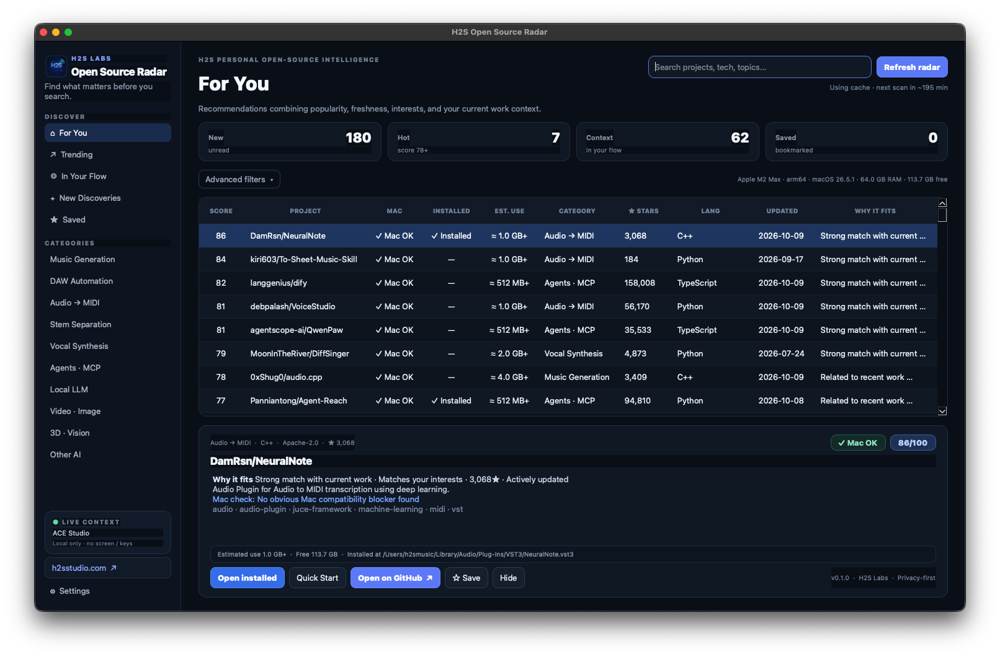

# H2S Open Source Radar

**A privacy-first macOS radar that recommends open-source AI projects based on what you care about and what you are working on right now.**

[H2S Studio](https://h2sstudio.com) · macOS · Python · PySide6 · GitHub Search API



## Why

Finding useful open-source AI projects is getting harder as GitHub grows. H2S Open Source Radar combines public repository signals with your interests and lightweight local work context so you can discover relevant tools without repeatedly writing search prompts.

It was built with music and creative automation in mind, but also tracks agents/MCP, local LLMs, image/video AI, and 3D/vision projects.

## Highlights

- **For You** ranking based on stars, freshness, recent activity, interests, and local work context.
- **English-first UI with complete Korean UI support** selectable in Settings. Language changes relaunch the app and also localize recommendation reasons/categories.
- **In Your Flow** recommendations related to currently running creative/developer apps.
- **Trending**, **New Discoveries**, **Saved**, search, hide, and category filters.
- **Mac compatibility status** for every recommendation, using Apple Silicon/macOS hints, RAM, free disk space, language portability, and verified release metadata.
- **Installed detection** for macOS apps, selected AU/VST3/CLAP plug-ins, common CLI locations, and H2S-managed installs.
- **Install-size guidance** with conservative estimated installed footprint before installation, exact GitHub release download size when available, current free disk space, and actual installed size for H2S-managed installs.
- **Advanced filters** for Mac-ready / one-click-ready / review / incompatible, installed state, estimated size, license family, update age, and minimum Stars.
- **H2S Easy Install** enables the install button only after a compatible official GitHub release asset has been verified. ZIP/TAR/DMG installs stay inside the selected H2S Tools folder; PKG files open Apple's Installer for required system approval.
- **Quick Start** appears after installation with a short category-specific 4-step guide.
- Music-focused categories including Music Generation, DAW Automation, Audio → MIDI, Stem Separation, and Vocal Synthesis.
- Optional background refresh with a local cache to avoid unnecessary GitHub API calls.
- macOS menu-bar presence and login launch.
- Optional `GITHUB_TOKEN` support for higher GitHub API limits.

## Privacy by default

The default context model uses:

- names of relevant running applications;
- recent project **file names and extensions** from a small set of local project roots;
- user-entered interests.

It does **not** collect keystrokes, screenshots, clipboard contents, file bodies, microphone audio, or screen recordings.

Recommendation/context data is stored locally in:

```text
~/Library/Application Support/H2S Open Source Radar/
```

See [PRIVACY.md](PRIVACY.md) for details.

## Install from source

Requirements:

- macOS 13+
- Python 3.10+

```bash
git clone https://github.com/h2sLabs/h2s-open-source-radar.git
cd h2s-open-source-radar

python3 -m venv .venv
source .venv/bin/activate
pip install -r requirements.txt

python app.py
```

Optional GitHub authentication:

```bash
export GITHUB_TOKEN="your_token"
python app.py
```

The token is read from the process environment and is not written to the app database by this project.

## Build the macOS app

```bash
pip install -r requirements-dev.txt
pyinstaller --noconfirm "H2S Open Source Radar.spec"
```

For the dependency set reviewed for v0.1.0, use `requirements-lock.txt`. The build configuration currently targets Apple Silicon (`arm64`).


## H2S Easy Install

Choose an install folder once in Settings (default: `~/Applications/H2S Tools`). After that, supported projects can be installed from the project detail pane.

Before enabling **Easy Install**, Radar checks the current Mac and the latest official GitHub Release. A one-click button is enabled only when the app can identify a compatible, GitHub-hosted macOS asset with sufficient confidence and enough free disk space. Unsupported or ambiguous releases remain disabled rather than running arbitrary setup scripts.

The size shown in the list is a conservative **estimated installed footprint**, not a promise. Models, checkpoints, caches, and optional data can require additional space. When a release is checked, the exact download size is also shown; for H2S-managed installs, the actual installed size is stored after installation.

Radar does not bypass Gatekeeper, administrator prompts, or Apple's Installer. System-level PKG installers may still ask the user for macOS approval.

## How ranking works

The recommendation score is intentionally understandable rather than opaque. It combines:

1. repository popularity;
2. recency of repository activity;
3. project freshness;
4. overlap with interests;
5. overlap with recent local work context.

The UI shows a human-readable **Why it fits** explanation for each project.

## Categories

- Music Generation
- DAW Automation
- Audio → MIDI / transcription
- Stem Separation
- Vocal / Singing Synthesis
- Agents / MCP
- Local LLM
- Video / Image AI
- 3D / Vision
- Other AI

## License

The application source code is licensed under the **Apache License 2.0**. See [LICENSE](LICENSE) and [NOTICE](NOTICE).

PySide6 / Qt for Python and other dependencies remain under their own licenses. See [THIRD_PARTY_NOTICES.md](THIRD_PARTY_NOTICES.md).

The H2S names and visual brand assets are not granted as trademarks by the Apache-2.0 license. See [assets/README.md](assets/README.md).

> The first public release is source-first. Prebuilt macOS binaries should only be redistributed after re-checking the exact packaged Qt/PySide6 components and including all applicable license notices.

## Contributing

Contributions are welcome. Please read [CONTRIBUTING.md](CONTRIBUTING.md), especially the privacy and dependency-license rules.

## Project

**H2S Labs**  
AI · Music · Creative Automation  
https://h2sstudio.com
